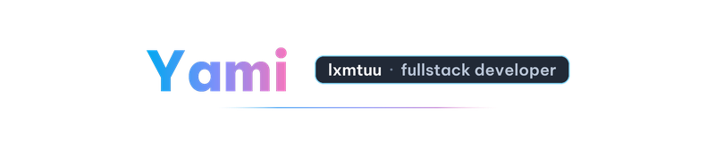
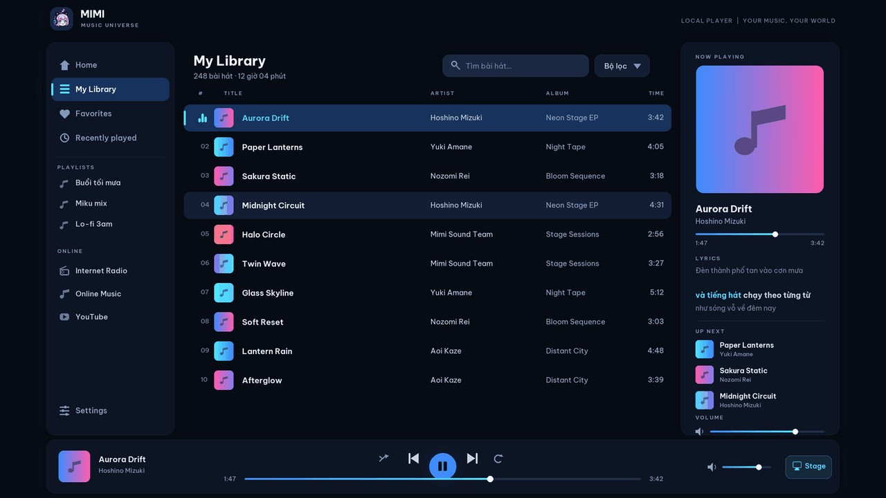
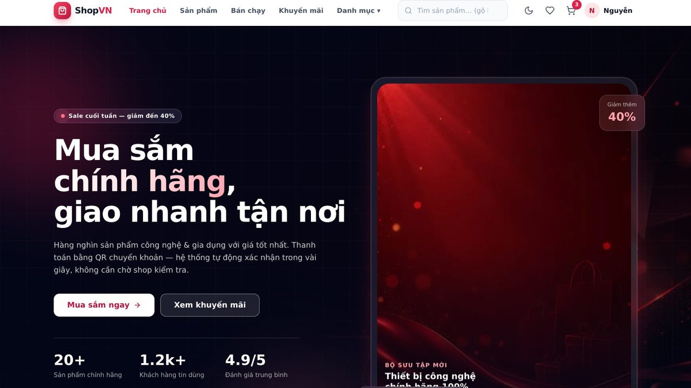
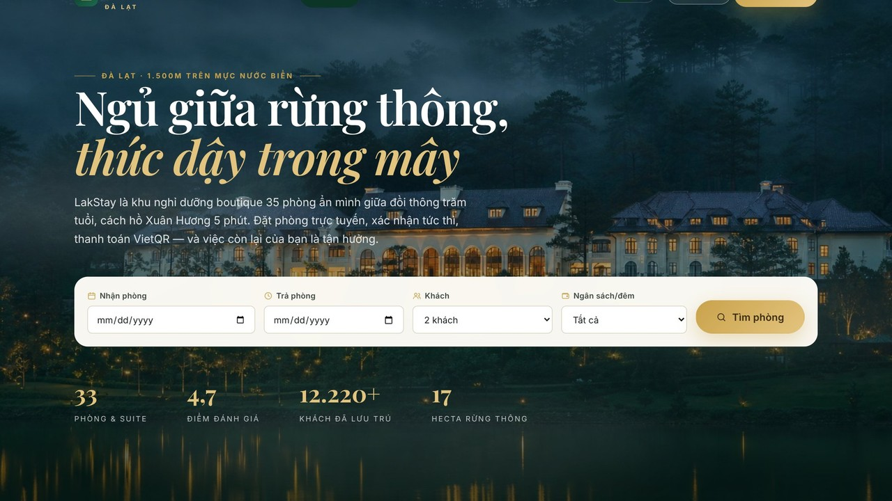
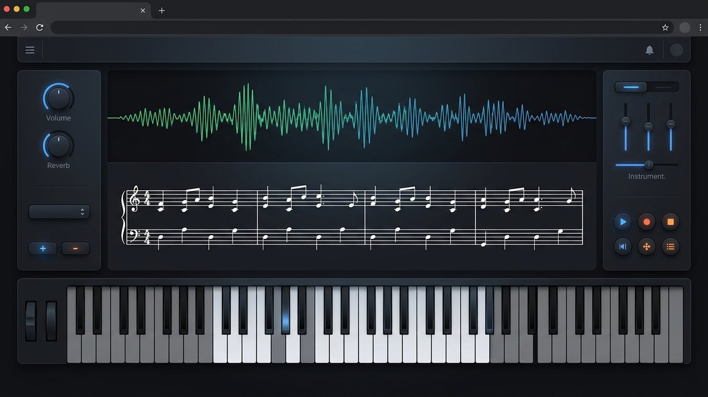
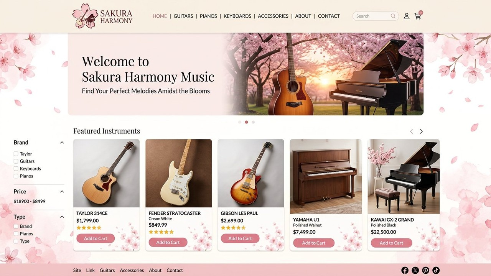
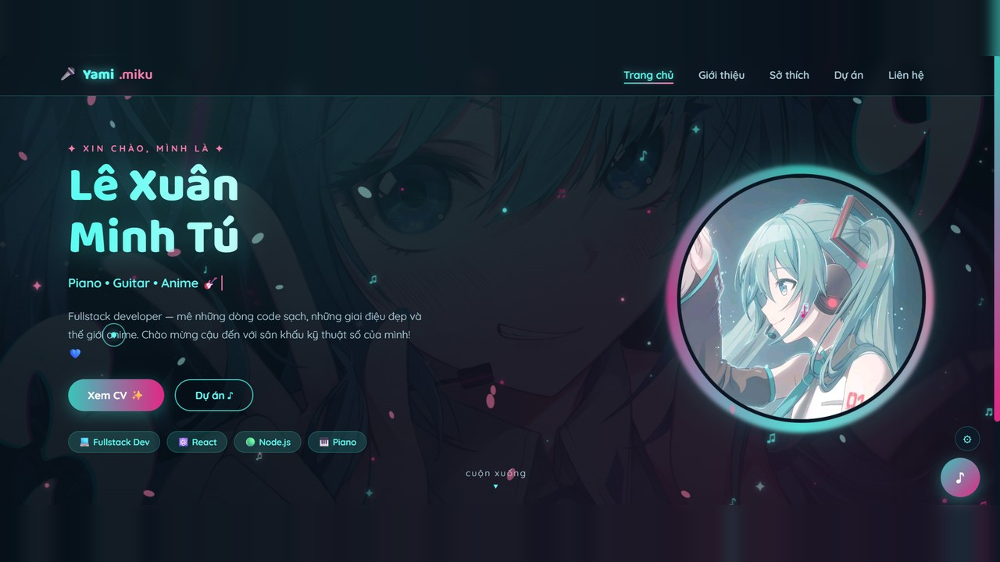

<!-- ========================================================================
     HERO — banner + name + role + plain-text links
     ======================================================================== -->

 

<!-- nameplate: gradient wordmark + handle chip + gradient rule (drawn, not a font hack) -->

<!-- animated typing -->

  

Đà Lạt, Vietnam &nbsp;·&nbsp; piano, cats &amp; MIDI &nbsp;·&nbsp; the occasional GPU shader

  

<a href="http://lxmtuu.id.vn/">Website</a> &nbsp;·&nbsp;
<a href="https://github.com/lxmtuu?tab=repositories">GitHub</a> &nbsp;·&nbsp;
<a href="https://www.facebook.com/lxmtuu">Facebook</a> &nbsp;·&nbsp;
<a href="https://x.com/neyu_2004">X</a> &nbsp;·&nbsp;
<a href="https://www.instagram.com/lx_mtuu/">Instagram</a> &nbsp;·&nbsp;
<a href="https://www.youtube.com/@eirlys_neyu">YouTube</a> &nbsp;·&nbsp;
<a href="mailto:lexuanminhtufw@gmail.com">Email</a>

 

<!-- ========================================================================
     ABOUT
     ======================================================================== -->

## 👋 About

I build things end to end — desktop apps in **C# / .NET** and fullstack web products.
Most of what I make ends up revolving around music: players, piano visualisers, MIDI tools.

 

<table>
  <tr>
    <td align="left" width="34%">🎓 &nbsp;<b>Role</b></td>
    <td align="left">Fullstack Developer — Software Engineer</td>
  </tr>
  <tr>
    <td align="left">🌐 &nbsp;<b>Languages</b></td>
    <td align="left">Vietnamese (native) · English (working proficiency)</td>
  </tr>
  <tr>
    <td align="left">💻 &nbsp;<b>Focus</b></td>
    <td align="left">Desktop apps · fullstack web · audio &amp; MIDI</td>
  </tr>
  <tr>
    <td align="left">🤝 &nbsp;<b>Open to</b></td>
    <td align="left">Open-source collaboration, real-world projects</td>
  </tr>
  <tr>
    <td align="left">🏆 &nbsp;<b>GitHub</b></td>
    <td align="left">Quickdraw · Pair Extraordinaire · Pull Shark ×2 · YOLO · Developer Program</td>
  </tr>
</table>

 

<!-- ========================================================================
     NOW
     ======================================================================== -->

## 🌱 Now

**Building** &nbsp;—&nbsp; **Mimi** *(v0.7.0 shipped)*, **KeyFlow**, and fullstack web products
 
**Learning** &nbsp;—&nbsp; system design, DevOps, TypeScript deep dive
 
**Ask me about** &nbsp;—&nbsp; C# / .NET, Next.js, Express, PostgreSQL, SQLite, piano VFX

 

<!-- ========================================================================
     PROJECTS — images carry the weight, text is quiet
     ======================================================================== -->

## 🚀 Selected work

Six things I am happy with — the rest lives <a href="https://github.com/lxmtuu?tab=repositories">on GitHub</a>.

  

<table>
  <tr>
    <td colspan="2" align="center">
      
    </td>
  </tr>
  <tr>
    <td width="50%" align="center" valign="top">
      
        
      <b>Mimi</b> &nbsp;· music player for Windows
       
      Offline-first · word-by-word lyrics · fullscreen Stage No account, no telemetry
        
      <code>C#</code> <code>.NET 8</code> <code>WPF</code> <code>NAudio</code>
        
      <a href="https://github.com/lxmtuu/Mimi/releases/latest">↓ Download v0.7.0</a> &nbsp;·&nbsp;
      <a href="https://github.com/lxmtuu/Mimi">Source</a>
    </td>
    <td width="50%" align="center" valign="top">
      
        
      <b>KeyFlow</b> &nbsp;· piano performance &amp; concert VFX
       
      Real-time note rendering · Direct3D 11 shaders MIDI-driven visuals, its own release channel
        
      <code>C#</code> <code>.NET 10</code> <code>WPF</code> <code>HLSL</code>
        
      <a href="http://ymkeyflow.online/">Website</a> &nbsp;·&nbsp;
      <a href="https://github.com/lxmtuu/KeyFlow/releases/latest">↓ Download v2.2.0</a> &nbsp;·&nbsp;
      <a href="https://github.com/lxmtuu/PianoPath">Source</a>
    </td>
  </tr>
</table>

 

<table>
  <tr>
    <td colspan="3" align="center">
      
    </td>
  </tr>
  <tr>
    <td width="33%" align="center" valign="top">
      
        
      <b>ShopVN</b>
       
      Fullstack e-commerce with automated VietQR reconciliation
        
      <code>Next.js 15</code> <code>Express 5</code> <code>PostgreSQL</code>
        
      <a href="https://shopvn-demo-seven.vercel.app">Demo</a> &nbsp;·&nbsp;
      <a href="https://github.com/lxmtuu/shopvn-ecommerce-fullstack">Source</a>
    </td>
    <td width="33%" align="center" valign="top">
      
        
      <b>LakStay Đà Lạt</b>
       
      Boutique hotel booking — anti-overbooking ledger, VietQR, PDF vouchers
        
      <code>Node.js</code> <code>Express</code> <code>SQLite</code>
        
      <a href="https://lakstay-demo.vercel.app">Demo</a> &nbsp;·&nbsp;
      <a href="https://github.com/lxmtuu/lakstay">Source</a>
    </td>
    <td width="33%" align="center" valign="top">
      
        
      <b>Melody House</b>
       
      Fullstack web MIDI piano platform with a real-time audio workstation UI
        
      <code>React</code> <code>Express</code> <code>Prisma</code>
        
      <a href="https://github.com/lxmtuu/melody-house-protect">Source</a>
    </td>
  </tr>
  <tr>
    <td width="33%" align="center" valign="top">
      
        
      <b>Sakura Music Shop</b>
       
      Instrument store front end — catalogue, filters, cart
        
      <code>Node.js</code> <code>JavaScript</code> <code>CSS</code>
        
      <a href="https://sakura-music-preview.vercel.app">Demo</a> &nbsp;·&nbsp;
      <a href="https://github.com/lxmtuu/sakura-music">Source</a>
    </td>
    <td width="33%" align="center" valign="top">
      
        
      <b>miku-portfolio</b>
       
      Personal portfolio site — hand-built, no framework
        
      <code>HTML</code> <code>CSS</code> <code>JavaScript</code>
        
      <a href="https://github.com/lxmtuu/miku-portfolio">Source</a>
    </td>
    <td width="33%" align="center" valign="top">
      ▸ &nbsp;More on GitHub
        
      
        <a href="https://github.com/lxmtuu/KeyFlow-Website">KeyFlow-Website</a> 
        <a href="https://github.com/lxmtuu/Anistream">Anistream</a> 
        <a href="https://github.com/lxmtuu/BrumeHotel">BrumeHotel</a> 
        <a href="https://github.com/lxmtuu/Umaru">Umaru</a>
      
        
      <a href="https://github.com/lxmtuu?tab=repositories">13 more →</a>
    </td>
  </tr>
</table>

 

## 🛠 Stack

  

 

<table>
  <tr>
    <td align="left" width="34%">🖥 &nbsp;<b>Desktop</b></td>
    <td align="left">C# · .NET 8 / .NET 10 · WPF · NAudio / WASAPI · Direct3D 11 · HLSL</td>
  </tr>
  <tr>
    <td align="left">🎨 &nbsp;<b>Frontend</b></td>
    <td align="left">React 19 · Next.js 15 · Tailwind v4 · TypeScript · HTML · CSS</td>
  </tr>
  <tr>
    <td align="left">⚙️ &nbsp;<b>Backend</b></td>
    <td align="left">Node.js · Express 5 · REST · Prisma · Zod · VietQR · PDFKit</td>
  </tr>
  <tr>
    <td align="left">🗄 &nbsp;<b>Data</b></td>
    <td align="left">PostgreSQL · SQLite (FTS5) · MongoDB</td>
  </tr>
  <tr>
    <td align="left">🚀 &nbsp;<b>Tooling</b></td>
    <td align="left">Docker · Git · GitHub Actions · Inno Setup · Python · PowerShell</td>
  </tr>
  <tr>
    <td align="left">✏️ &nbsp;<b>Design</b></td>
    <td align="left">Figma · VS Code · docs-first development</td>
  </tr>
</table>

 

<!-- ========================================================================
     EXPERIENCE
     ======================================================================== -->

## 💼 Experience

<table>
  <tr>
    <td align="left" width="22%" valign="top">
      <b>2024 – Present</b> 
      Freelance / personal
    </td>
    <td align="left" valign="top">
      <b>Fullstack &amp; Desktop Developer</b> &nbsp;· Vietnam, remote
        
      
        ▸ &nbsp;Ship desktop and fullstack products end to end — concept, build, installer, CI, docs 
        ▸ &nbsp;<b>Mimi</b> — offline-first Windows music player: WASAPI playback, word-by-word Enhanced LRC,
        SQLite FTS5 search that ignores Vietnamese diacritics, beat-reactive fullscreen Stage 
        ▸ &nbsp;<b>KeyFlow</b> — piano performance and concert VFX studio on Direct3D 11, with its own release channel 
        ▸ &nbsp;<b>ShopVN</b> — e-commerce on Next.js 15 and Express 5, VietQR webhooks reconciling orders automatically 
        ▸ &nbsp;<b>LakStay Đà Lạt</b> — hotel booking with an anti-overbooking concurrency ledger and PDF A4 vouchers
      
    </td>
  </tr>
</table>

 

<!-- ========================================================================
     STATS — one block, quiet
     ======================================================================== -->

## 📊 Numbers

  
  

 

  
    <a href="https://wakatime.com/@5908a739-21fe-4d77-9bbc-e36215edc052">WakaTime — language &amp; project time, updated weekly</a>
  

 

<!-- ========================================================================
     ACHIEVEMENTS + CONTACT
     ======================================================================== -->

## 🏆 Achievements

  

 

  
  &nbsp;
  
  &nbsp;
  
  &nbsp;
  

 

## 📬 Say hello

<a href="mailto:lexuanminhtufw@gmail.com">lexuanminhtufw@gmail.com</a>

  

<a href="http://lxmtuu.id.vn/">Website</a> &nbsp;·&nbsp;
<a href="https://github.com/lxmtuu?tab=repositories">GitHub</a> &nbsp;·&nbsp;
<a href="https://www.facebook.com/lxmtuu">Facebook</a> &nbsp;·&nbsp;
<a href="https://x.com/neyu_2004">X</a> &nbsp;·&nbsp;
<a href="https://www.instagram.com/lx_mtuu/">Instagram</a> &nbsp;·&nbsp;
<a href="https://www.youtube.com/@eirlys_neyu">YouTube</a>

  

Open to collaboration — or just want to talk about dev and piano.

  

