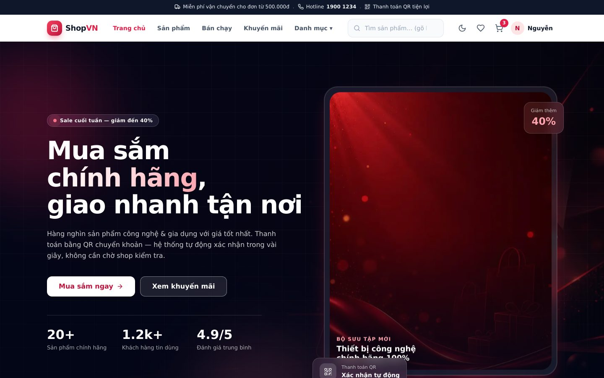
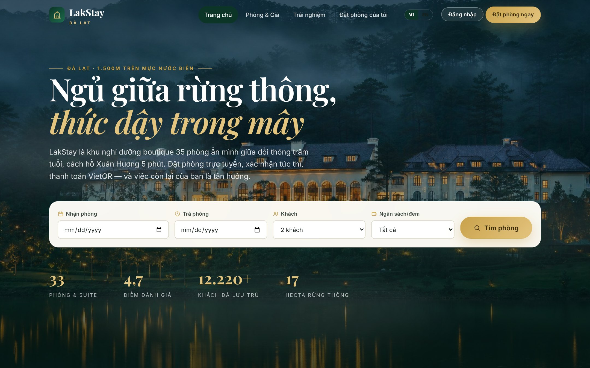
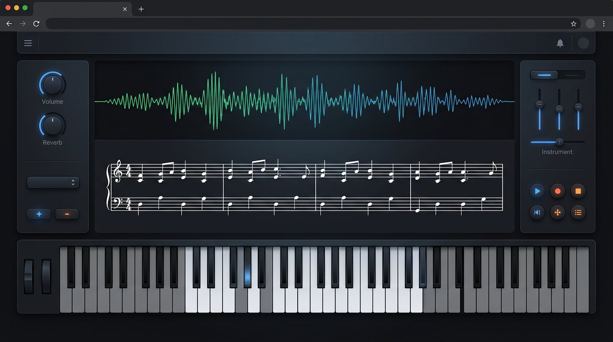
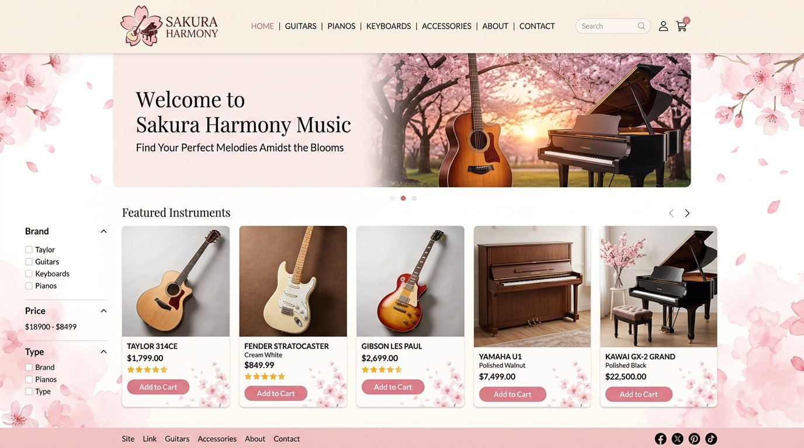
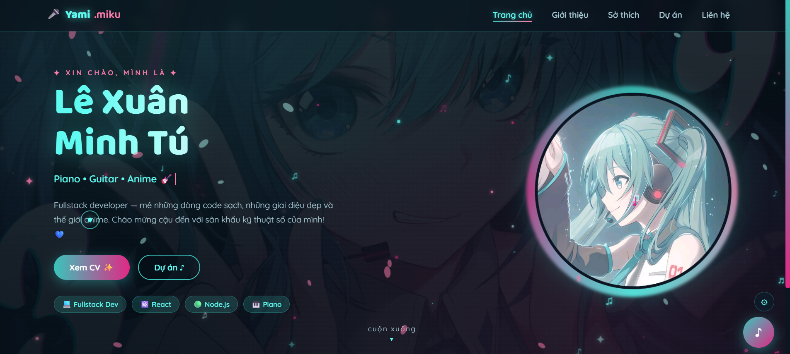

<!-- ========================================================================
     HERO BANNER
     ======================================================================== -->

<!-- ========================================================================
     ANIMATED TYPING (màu xanh banner)
     ======================================================================== -->

  

 

<!-- ========================================================================
     SOCIAL LINKS
     ======================================================================== -->

  
  
  
  
  
  

 

<!-- ========================================================================
     VISITOR COUNTER (màu xanh banner)
     ======================================================================== -->

  

 

<!-- ========================================================================
     ABOUT ME
     ======================================================================== -->

  
<b>👋 Hi, I'm Yami (lxmtuu)</b>

   
  <table>
    <tr>
      <td align="center" width="220">
        
          
        <b>lxmtuu</b> · Yami
         <i>Fullstack Developer · Software Engineer</i>
      </td>
      <td align="left">
         
        🎓 <b>Fullstack Developer - Software Engineer</b> 
        🏠 Based in <b>Vietnam 🇻🇳</b> (Remote) 
        🌐 Languages: Vietnamese (native) · English (working proficiency) 
        🎹 Passions: Piano, cats 🐱, MIDI music, and creative technology 
        💻 Building web products, music platforms, and practical tools 
        🤝 Open to collaboration on open-source and real-world projects 
         
        🏆 <b>GitHub Achievements:</b> Quickdraw · Pair Extraordinaire · Pull Shark ×2 · YOLO · GitHub Developer Program Member
      </td>
    </tr>
  </table>

 

<!-- ========================================================================
     WHAT I'M DOING NOW
     ======================================================================== -->

  
<b>🌱 Currently</b>

   
  <table>
    <tr>
      <td width="50%" align="left">
        <b>🔭 Working on</b> 
        Fullstack web applications &amp; music platforms
      </td>
      <td width="50%" align="left">
        <b>🌱 Learning</b> 
        System design · DevOps · TypeScript deep dive
      </td>
    </tr>
    <tr>
      <td width="50%" align="left">
        <b>👯 Collaborate on</b> 
        Open-source · MIDI/audio projects · Creative tech
      </td>
      <td width="50%" align="left">
        <b>💬 Ask me about</b> 
        C# / .NET · Next.js · Express · PostgreSQL · SQLite · Piano VFX
      </td>
    </tr>
  </table>

 

<!-- ========================================================================
     GITHUB STATS (màu banner)
     ======================================================================== -->
<table>
  <tr>
    <td>
      
    </td>
    <td>
      
    </td>
  </tr>
  <tr>
    <td colspan="2" align="center">
      
    </td>
  </tr>
</table>

 

<!-- ========================================================================
     WAKATIME CODING STATS
     ======================================================================== -->

  
<b>📊 WakaTime Coding Stats</b>

   
  

    
  

  

    <b>Thời gian code theo ngôn ngữ &amp; dự án</b> — cập nhật hàng tuần trên WakaTime. 
    Nhấn vào badge để xem chi tiết hành trình code của tôi.
  

 

<!-- ========================================================================
     TECH STACK
     ======================================================================== -->

  
<b>🛠 Tech Stack</b>

   
  

    
  

   
  <table>
    <tr>
      <td align="center"><b>Desktop &amp; Graphics</b></td>
      <td align="center"><b>Frontend</b></td>
      <td align="center"><b>Backend</b></td>
      <td align="center"><b>Database</b></td>
      <td align="center"><b>DevOps &amp; Tools</b></td>
    </tr>
    <tr>
      <td align="center">C# · .NET 10 · WPF · Direct3D 11 · HLSL</td>
      <td align="center">React 19 · Next.js 15 · Tailwind CSS v4 · JavaScript · TypeScript · HTML5 · CSS3</td>
      <td align="center">Node.js · Express 5 · REST API · Prisma · Zod · VietQR</td>
      <td align="center">PostgreSQL · SQLite · MongoDB</td>
      <td align="center">Docker · Python · PowerShell · Inno Setup · Git · GitHub · Figma · VS Code</td>
    </tr>
  </table>

 

<!-- ========================================================================
     EXPERIENCE
     ======================================================================== -->

  
<b>💼 Experience</b>

   
  <table>
    <tr>
      <td align="center" width="200"><b>2024 – Present</b></td>
      <td align="left">
        <b>Fullstack &amp; Desktop Developer · Freelance / Personal Projects</b> 
        Vietnam (Remote) 
        • Designed and developed desktop &amp; fullstack web applications from concept to deployment 
        • Built <b>KeyFlow</b> (desktop piano performance &amp; concert VFX studio with Direct3D 11 GPU shaders), <b>ShopVN</b> (fullstack e-commerce with Next.js 15, Express 5, PostgreSQL &amp; automated VietQR webhook reconciliation), <b>LakStay Đà Lạt</b> (boutique hotel booking system with anti-overbooking concurrency ledger, dynamic pricing, VietQR EMVCo &amp; PDF A4 vouchers), and web MIDI piano platforms 
        • Tech stack: C#, .NET 10, WPF, HLSL, Next.js 15, React 19, Express, PostgreSQL, SQLite, Prisma, Docker, TypeScript, JavaScript, Python, PowerShell
      </td>
    </tr>
  </table>

 

<!-- ========================================================================
     PROJECTS
     ======================================================================== -->

  
<b>🚀 Featured Projects</b>

   

  <table>
    <tr>
      <td width="33%" align="center" valign="top">
        
          
        <b>🎹 KeyFlow (PianoPath)</b> 
        Piano Performance &amp; Concert VFX Studio 
        C# · .NET 10 · HLSL · Python · PowerShell · Inno Setup · HTML 
         
        
        
      </td>
      <td width="33%" align="center" valign="top">
        
          
        <b>🛒 shopvn-ecommerce-fullstack</b> 
        ShopVN — Fullstack E-commerce &amp; VietQR Auto-Confirm 
        Next.js 15 · React 19 · Express 5 · PostgreSQL · Prisma · Tailwind v4 · TypeScript · Docker 
         
        
        
      </td>
      <td width="33%" align="center" valign="top">
        
          
        <b>🏨 lakstay</b> 
        LakStay Đà Lạt — Fullstack Hotel Booking System 
        Node.js · Express · SQLite · JavaScript · VietQR EMVCo · PDFKit · Zod · Docker 
         
        
        
      </td>
    </tr>
    <tr>
      <td width="33%" align="center" valign="top">
        
          
        <b>🎹 melody-house-protect</b> 
        Fullstack Web MIDI Piano Platform 
        JavaScript 
         
        
      </td>
      <td width="33%" align="center" valign="top">
        
          
        <b>🌸 sakura-music</b> 
        Instrument Shop Website 
        JavaScript · E-commerce UI 
         
        
      </td>
      <td width="33%" align="center" valign="top">
        
          
        <b>🖼 miku-portfolio</b> 
        Portfolio Website 
        JavaScript 
         
        
      </td>
    </tr>
  </table>

   

  

    
<b>📘 ShopVN — Kiến trúc &amp; Tài liệu dự án (Fullstack E-commerce)</b>

     
    <table>
      <tr>
        <td align="left">
          <b>🌐 Live Preview:</b> <a href="https://shopvn-demo-seven.vercel.app">shopvn-demo-seven.vercel.app</a> · <b>📦 Repo:</b> <a href="https://github.com/lxmtuu/shopvn-ecommerce-fullstack">lxmtuu/shopvn-ecommerce-fullstack</a>  
          • <b>Quy mô hệ thống:</b> ~17.300 dòng mã · <b>104</b> REST API endpoints · <b>26</b> Prisma models (PostgreSQL 16, 37 indexes) · <b>30</b> trang Next.js 15 (17 khách hàng + 12 quản trị) · <b>43</b> Vitest tests 
          • <b>Thanh toán &amp; Tồn kho:</b> Sinh mã <b>VietQR chuẩn EMVCo</b> theo mã đơn, đối soát tự động qua webhook ký <b>HMAC-SHA256</b> trong transaction Serializable, trừ kho nguyên tử chống bán lố và cron tự huỷ đơn quá hạn sau 15 phút 
          • <b>Bảo mật &amp; Vận hành:</b> Cookie <code>httpOnly</code> + Refresh Token Rotation (phát hiện reuse thu hồi cả token family), RBAC, Audit Log quản trị, đánh giá gắn huy hiệu <i>Đã mua hàng</i> và Swagger OpenAPI  
          <b>📚 Tài liệu chi tiết trong repo:</b>
          <a href="https://github.com/lxmtuu/shopvn-ecommerce-fullstack/blob/main/docs/01-LO-TRINH-ROADMAP.md">01 Roadmap</a> ·
          <a href="https://github.com/lxmtuu/shopvn-ecommerce-fullstack/blob/main/docs/02-YEU-CAU-CHUC-NANG.md">02 SRS</a> ·
          <a href="https://github.com/lxmtuu/shopvn-ecommerce-fullstack/blob/main/docs/03-KIEN-TRUC-VA-DATABASE.md">03 Kiến trúc &amp; DB</a> ·
          <a href="https://github.com/lxmtuu/shopvn-ecommerce-fullstack/blob/main/docs/04-BAO-MAT-VA-TICH-HOP.md">04 Bảo mật &amp; VietQR</a> ·
          <a href="https://github.com/lxmtuu/shopvn-ecommerce-fullstack/blob/main/docs/05-SETUP-VA-YEU-CAU.md">05 Yêu cầu</a> ·
          <a href="https://github.com/lxmtuu/shopvn-ecommerce-fullstack/blob/main/docs/06-UI-UX-DESIGN-SYSTEM.md">06 Design System</a> ·
          <a href="https://github.com/lxmtuu/shopvn-ecommerce-fullstack/blob/main/docs/07-HUONG-DAN-CAI-DAT-VA-CHAY-DU-AN.md">07 Cài đặt &amp; Demo</a> ·
          <a href="https://github.com/lxmtuu/shopvn-ecommerce-fullstack/blob/main/docs/08-BAO-CAO-RA-SOAT.md">08 Báo cáo Rà soát</a> ·
          <a href="https://github.com/lxmtuu/shopvn-ecommerce-fullstack/tree/main/docs/screenshots">13 Screenshots</a>
        </td>
      </tr>
    </table>
  

   

  

    
<b>📗 LakStay Đà Lạt — Kiến trúc &amp; Tài liệu dự án (Hotel Booking System)</b>

     
    <table>
      <tr>
        <td align="left">
          <b>🌐 Live Preview:</b> <a href="https://lakstay-demo.vercel.app">lakstay-demo.vercel.app</a> (<a href="https://lakstay-demo.vercel.app/admin.html">Cổng Quản trị &amp; Lễ tân</a>) · <b>📦 Repo:</b> <a href="https://github.com/lxmtuu/lakstay">lxmtuu/lakstay</a>  
          • <b>Quy mô hệ thống:</b> Khách sạn boutique <b>35 phòng / 6 hạng phòng</b> tại Đà Lạt · <b>18</b> bảng chuẩn hoá + auto-migration · 2 SPA độc lập (Khách lưu trú <code>VI/EN</code> &amp; Quản trị/Lễ tân) · <b>139</b> kịch bản test tự động (Unit + E2E Smoke + Concurrency) 
          • <b>Nghiệp vụ lõi Backend:</b> Chống <b>Overbooking tuyệt đối</b> bằng sổ cái <code>room_calendar</code> + <code>BEGIN IMMEDIATE</code> (vượt 40 request đồng thời tranh 2 phòng cuối, 0 overbooking), Booking State Machine có Optimistic Locking (<code>version</code>), định giá động theo mùa/cuối tuần &amp; chính sách hoàn huỷ 3 tầng 
          • <b>Thanh toán, Chứng từ &amp; Bảo mật:</b> <b>VietQR EMVCo + CRC-16</b>, Webhook HMAC + <code>Idempotency-Key</code>, phát hành <b>Voucher PDF A4 tiếng Việt</b> kèm xác thực QR, chương trình tích điểm Loyalty (<code>MEMBER → PLATINUM</code>), Cookie <code>httpOnly</code> + Refresh Token Rotation + CSRF Double-Submit  
          <b>📚 Tài liệu chi tiết trong repo:</b>
          <a href="https://github.com/lxmtuu/lakstay/blob/main/docs/ARCHITECTURE.md">Architecture</a> ·
          <a href="https://github.com/lxmtuu/lakstay/blob/main/docs/API.md">API Reference</a> ·
          <a href="https://github.com/lxmtuu/lakstay/blob/main/docs/SECURITY.md">Security</a> ·
          <a href="https://github.com/lxmtuu/lakstay/blob/main/docs/SETUP.md">Setup Guide</a> ·
          <a href="https://github.com/lxmtuu/lakstay/blob/main/docs/ROADMAP.md">Roadmap</a> ·
          <a href="https://github.com/lxmtuu/lakstay/tree/main/docs/screenshots">12 Screenshots</a>
        </td>
      </tr>
    </table>
  

   

  

    
  

 

<!-- ========================================================================
     ACHIEVEMENTS
     ======================================================================== -->

  
<b>🏆 GitHub Achievements</b>

   
  

    
    
    
    
  

 

<!-- ========================================================================
     CONTACT
     ======================================================================== -->

  
<b>📬 Contact &amp; Support</b>

   
  <table>
    <tr>
      <td align="center">
        
      </td>
      <td align="center">
        
      </td>
      <td align="center">
        
      </td>
    </tr>
    <tr>
      <td align="center">
        
      </td>
      <td align="center">
        
      </td>
      <td align="center">
        
      </td>
    </tr>
  </table>

 

<!-- ========================================================================
     FOOTER
     ======================================================================== -->

  <b>Thanks for visiting my profile!</b> ✨ 
  Open to collaboration or just want to talk about dev and piano — feel free to reach out.

